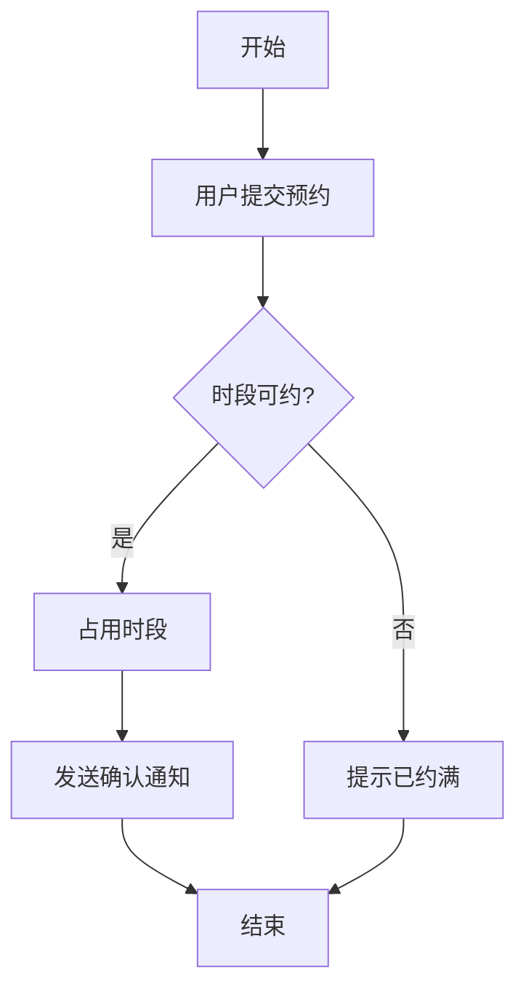
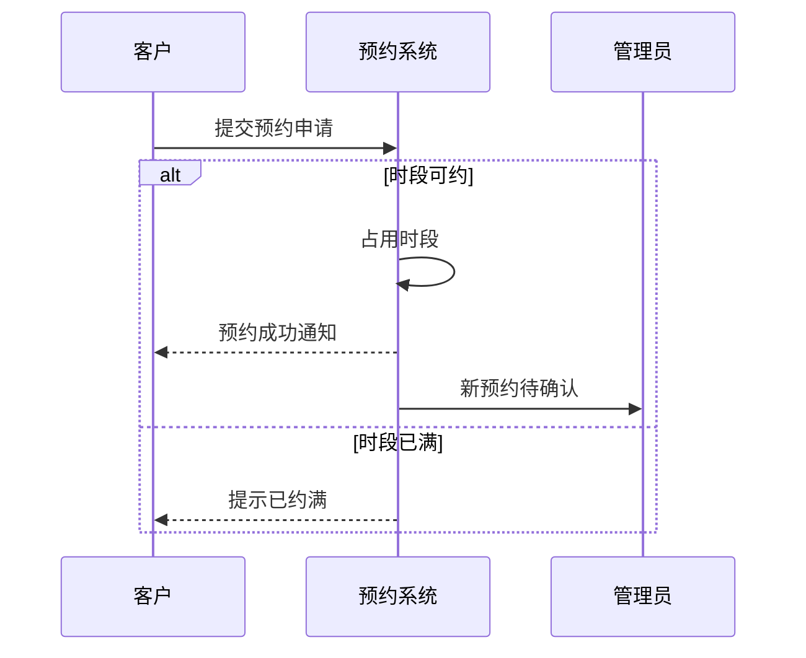
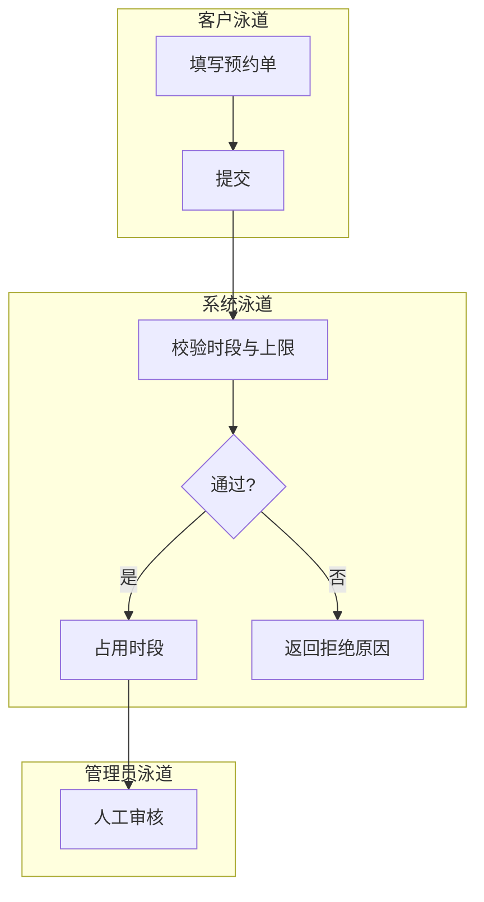
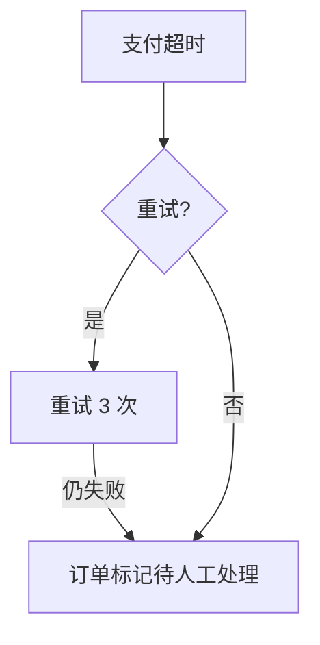

# PRD 模板（中文）

按以下章节写作。所有占位符（如《产品名》）替换为实际内容；"模板示例"里的文字是示范写法，不要照抄，只保留结构。非功能需求等处的示例数值同样不可照抄——量化值必须来自访谈，访谈没问到的写进第 13 节并标注为假设。

---

## 0. 文档定位说明

> 本文档是《产品名》的产品需求文档（PRD），写给甲方（确认范围与验收）、开发（照规则实现）、测试（推导用例）三方。只包含业务需求、业务规则、验收标准；不含技术实现细节（框架、库、接口、字段），这些由后续设计文档承载。

## 1. 摘要

2-3 句话说明本文档讲什么，结尾加一行加粗结论。

**一句话结论：**（如：本版本交付预约、改期、取消三条主流程，不做支付与自动分配。）

## 2. 版本历史

| 版本 | 日期 | 作者/审批人 | 变更内容与原因 | 状态（草稿/评审中/已确认） |
|------|------|-------------|----------------|---------------------------|

- 已确认版本锁定，后续任何改动新增一行版本，引用 PRD 时必须带版本号。

## 3. 干系人与联系方式

| 角色 | 职责 | 姓名 | 联系方式 |
|------|------|------|---------|
| 甲方负责人 | 确认范围与验收 | 待定 | - |
| 产品经理 | 需求澄清与文档维护 | 待定 | - |
| 开发负责人 | 按 PRD 实现 | 待定 | - |
| 测试负责人 | 推导并执行验收用例 | 待定 | - |

## 4. 术语表（先行，正文用到前必须定义）

| 术语 | 定义 | 示例 / 反例 |
|------|------|-------------|
| 《术语》 | 一句话定义 | 例：…；注意与《另一术语》区分 |

- 一个概念只用一个名字，全文统一；正文出现新术语必须回来补表。
- 涉及计数的核心名词在术语表钉死粒度（一个"本"指单册还是书目、一张"单"含几张发票），同一名词全篇一个粒度。

## 5. 问题与目标

### 5.1 痛点

现状存在什么问题、谁受影响、影响是什么（尽量量化，如"平均排队 40 分钟"）。

### 5.2 目标与成功指标（KR 表）

| 指标 | 当前值 | 目标值 | 度量方式 |
|------|--------|--------|---------|
| 《指标》 | 基线 | 目标 | 数据来源与统计口径 |

度量方式不得以系统自身记录为唯一基准（如用"以系统记录为准"去验证"系统状态准确率"——指标将永远达标、不可证伪），应引入独立基准：现场人工核查、行政台账、第三方统计等。

### 5.3 验收门槛（定制/合同项目必填）

甲方签字验收的判据，回答"做到什么程度算交付完成"，如"验收演示通过全部主流程 + 1 周真实试运行无阻断性问题"。与 KR 的区别：KR 衡量上线后的成效，验收门槛定义交付完成的标准。

## 6. 范围与非范围

### 6.1 范围（本版本做什么）

| 功能 ID | 功能 | 说明 |
|---------|------|------|
| F1 | 《功能》 | 一句话行为 |

### 6.2 非范围（明确不做什么，宁多勿少）

| 不做什么 | 原因 | 后续怎么处理 |
|----------|------|-------------|
| 《事项》 | 一句理由 | 需要时作为新需求单独立项评估 |

## 7. 发布计划

- 里程碑用**相对时间框架**（如"需求确认后 4 周内首版上线"），不写精确日期。
- 标明首版与后续版本的划分，与 6.2 非范围保持一致；后续版本项需要时单独立项评估。

## 8. 用户故事与验收标准

每个功能 ID 至少对应一条用户故事，格式：

> 作为《角色》，我希望《能力》，以便《价值》。

（上一行是格式说明——正文必须为每个功能 ID 实际写出一条填好内容的故事，交付文档里不许只剩《》占位行。）

验收标准表（Given-When-Then，**每条故事至少 1 条正常 + 1 条异常；存在边界时补边界**）：

| AC ID | 功能 ID | 类型（正常/异常/边界） | Given（前置条件） | When（触发动作） | Then（可观察结果） |
|-------|---------|----------------------|-------------------|------------------|-------------------|
| AC-1 | F1 | 正常 | 库存有 5 个时段可约 | 用户提交有效预约 | 预约成功，用户收到确认，时段占用数 +1 |
| AC-2 | F1 | 异常 | 所选时段已被约满 | 用户提交预约 | 预约被拒，提示"该时段已约满"，可选相近时段 |
| AC-3 | F1 | 边界 | 用户已约满每日上限 3 次 | 用户再次提交 | 预约被拒，提示已达当日上限，引导走人工通道 |

覆盖要求：

- 功能 ID → AC 映射完整，测试可从本文档直接推导用例；
- 按行为写 AC，不按输入值穷举；
- 时刻/时限类断言写成含/不含端点的区间（如"10:15:00 及之前有效""10:15:01 起触发释放"），同一边界在 AC、正文、图里只用一种口径；涉及天数/时长计算的（如逾期天数），除判定端点外还需写明计算规则（按自然日差还是精确小时）。
- 每类通知事件标注渠道（应用内 / IM / 邮件）与接收人，全文口径一致，不留"收到通知"式的渠道悬空（推荐用 9.5 通知事件矩阵承载）。
- AC 的 Given 写入全部影响结果的初始条件（历史累计值、当前队列、在借数量等），不留隐藏前提。

**规则覆盖核对表**（必填：逐条列第 4、9、10 节的每条量化规则；任何一格为空即缺口，交审前必须补齐）：

| 规则（出处章节） | 失败/拒绝侧 AC | 成功/触发侧 AC |
|------------------|----------------|----------------|
| 例：借阅上限 3 本（9.3） | AC-2 | AC-1 |

## 9. 异常与边界

### 9.1 失败场景

| 异常场景 | 系统行为 | 用户提示 |
|----------|---------|---------|
| 《场景，如网络中断、第三方服务超时、重复提交》 | 《兜底规则，用业务语言》 | 《提示文案要点》 |

### 9.2 权限边界

| 角色 | 可以做 | 不可以做 |
|------|--------|---------|
| 《角色》 | 操作列表 | 明确禁止的操作 |

### 9.3 数据边界

| 数据项 | 边界规则（范围/长度/时效/条数） | 超出后行为 |
|--------|--------------------------------|-----------|
| 《数据项，如预约时间、手机号、上传文件》 | 量化约束 | 拒绝或降级的具体行为 |

### 9.4 状态与迁移（有状态流转的产品必填）

先列两个全集（状态词汇封闭：正文出现的任何状态词必须在全集内，新增状态先改全集再使用）：

- 受管对象状态全集：每类对象一张表（如单据：待审批/已批准/已驳回/已作废）；
- 主体状态全集（员工/账号等，若适用）：如 正常/停用中。

迁移矩阵（行 = 当前状态，列 = 事件，格 = 目标状态；**每一格都必须裁决**：填目标状态，或标"不可能（前置校验拒绝）"，空白格即未定义行为）：

| 当前状态 \ 事件 | 《事件1，如归还》 | 《事件2，如报失》 | 《事件3，如管理员报废》 |
|------------------|------------------|------------------|--------------------------|
| 在馆 | 已借出 | 不可能（仅对在借申报） | 已报废 |
| 已借出 | 在馆或保留中（按队列） | 遗失处理中 | 不可能（需先归还或报失） |
| 《终态，如已报废》 | 终态不迁移 | - | - |

### 9.5 通知事件矩阵（有通知的产品必填）

| 事件 | 触发时刻 | 渠道（应用内/IM/邮件） | 接收人 |
|------|---------|------------------------|--------|
| 《事件，如轮到取书》 | 《精确时刻或相对时刻》 | 《渠道》 | 《接收人》 |

## 10. 非功能需求

> 本节量化数值必须来自访谈（性能与并发量级是承重问题）；访谈未覆盖的，取值写入第 13 节并标注为假设。下方《》占位符必须替换为访谈得出的具体值——不可留空、不可编造、不可照抄别处示例。

### 10.1 性能（全部量化）

（写"系统需支撑的下限"（≥ 口径）——访谈得到的业务峰值是推导依据，不要把峰值事实本身当指标写。）

- 页面/接口响应时间（P95）：普通操作《目标值》，查询类《目标值》。
- 并发：《同时在线用户量级下限》；峰值《请求/秒量级下限》。
- 数据量：《单表/单库规模与增长预估》。

### 10.2 安全

- 认证与权限：登录方式、角色控制、越权访问一律拒绝。
- 数据保护：敏感信息（手机号、证件号）展示脱敏；传输加密；留存与删除规则。
- 防滥用：每个公开入口声明上限（如"每用户每日最多 20 次，超出转人工通道"）。

### 10.3 兼容性

- 设备/浏览器/系统：明确支持的最低版本（如"iOS 15+、Android 10+、Chrome 100+ 最新两个大版本"）。
- 数据格式：导入/导出格式与跨版本兼容规则。

## 11. 外部依赖与合同约束（不含实现细节）

只写合同级事实——外部凭证及其交付周期、谁为第三方服务付费、账号与数据归属、部署归属：

| 依赖/约束 | 内容 | 负责方 | 到位期限/前置条件 |
|----------|------|--------|------------------|
| 《如支付通道开通、短信签名审批、历史数据基线》 | 合同级事实 | 谁负责 | 期限或前置条件 |

结尾固定一句：**技术实现方案由后续设计文档另行承载，本 PRD 在此不做承诺。**

## 12. 业务流程（图）

每张图编号（图 12-N），标题注明对应的 AC 或规则编号；正文规则变了图必须跟着变。

### 12.1 主流程图（核心业务路径）

图 12-1：预约主流程（分支对应 AC-1 / AC-2）

### 12.2 泳道图（跨角色协作）

写法 A：sequenceDiagram，参与者=角色/系统，天然泳道感：

写法 B：flowchart + subgraph 横向分泳道：

### 12.3 异常流程图（可选，复杂失败路径单独画）

图 12-3：第三方支付超时处理（对应 9.1 失败场景）

## 13. 假设与待确认项

| 假设/待确认项 | 验证方式 | 兜底方案 |
|---------------|---------|---------|
| 《拷问未能确定的项》 | 如何验证 | 验证失败时怎么办 |

- 此表只放"问过了但没定下来"的项；没问就写出来的，是流程 bug，不是假设。

---

## 附：AC 编写要点（正常 / 异常 / 边界）

| 类型 | 回答的问题 | 必写场景 |
|------|-----------|---------|
| 正常 | 功能按预期工作时是什么样 | 主路径、核心规则生效、数据正确 |
| 异常 | 出错了怎么办 | 资源不足、并发抢占失败、超时、重复提交、权限不足、第三方失败 |
| 边界 | 临界值处如何表现 | 上限/下限、正好达到限额、空数据、最大长度、超长截断、时区/夏令时边界 |
